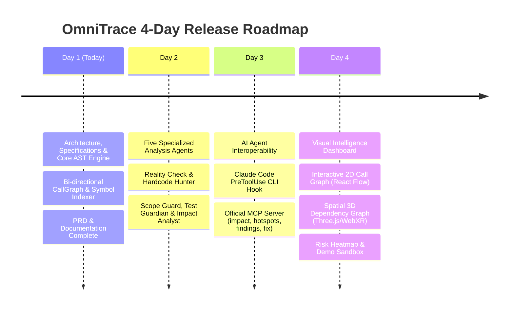

# OmniTrace 🛡️⚡
### *Real-Time Code Intelligence, Blast Radius Visualization & Safety Guardrails for AI Coding Agents*

[](https://www.typescriptlang.org/)
[](https://nodejs.org/)
[](./LICENSE)
[-brightgreen.svg)](#-4-day-progressive-release-plan)

OmniTrace observes code modifications in real time, deterministically maps dependency blast radiuses, catches breaking changes before they hit production, and protects codebases with pre-edit interception hooks and Model Context Protocol (MCP) integrations.

---

## 📅 4-Day Progressive Release Plan

This repository is being deployed in **4 focused, modular phases**:



| Phase | Milestone Name | Status | Key Deliverables |
|---|---|---|---|
| **Day 1** | **Part 1: Project Foundation & Core AST Engine** | **ACTIVE (Deployed Today)** | Monorepo setup, full PRD & specs, TypeScript Compiler API parser, in-memory `ProjectGraph`, incremental watcher, core test harness. |
| **Day 2** | **Part 2: The Five Analysis Agents & Findings Engine** | Upcoming (Tomorrow) | Reality Check, Hardcode Hunter, Scope Guard, Test Guardian, Impact Analyst, Patch & Rollback Manager. |
| **Day 3** | **Part 3: Coding Agent Integrations & Local Daemon** | Upcoming (Day 3) | Claude Code PreToolUse hook, Model Context Protocol (MCP) server, local Express + WebSocket server. |
| **Day 4** | **Part 4: Full Visual Intelligence Dashboard** | Upcoming (Day 4) | React 18 dashboard, 2D React Flow graph, 3D spatial Three.js / R3F visualizer, risk heatmap, demo sandbox. |

---

## 📦 What's Included in Day 1 (Part 1 of 4)

Today's release deploys the complete foundation, technical specifications, and static analysis engine:

1. **System Specifications & Architecture Documents (`docs/`)**:
   - [`PRD.md`](./docs/PRD.md): Product Requirements Document with 3 review passes and open decision resolutions.
   - [`FEATURE_SPECIFICATION.md`](./docs/FEATURE_SPECIFICATION.md): Inputs, outputs, deterministic logic, and acceptance criteria for all system components.
   - [`TECHNICAL_ARCHITECTURE.md`](./docs/TECHNICAL_ARCHITECTURE.md): Component diagrams, latency budgets ($< 150\text{ms}$ incremental re-indexing), and data flow.
   - [`DATABASE_SCHEMA.md`](./docs/DATABASE_SCHEMA.md): Local cache schema and Cloud Firestore security rules.
   - [`TESTING_STRATEGY.md`](./docs/TESTING_STRATEGY.md): Unit, integration, and edge-case testing matrices.
   - [`SECURITY_AND_PRIVACY.md`](./docs/SECURITY_AND_PRIVACY.md): Local-first guarantee and safe in-memory secret redaction policy.
   - [`IMPLEMENTATION_ROADMAP.md`](./docs/IMPLEMENTATION_ROADMAP.md): Engineering milestone roadmap.
   - [`DECISION_LOG.md`](./docs/DECISION_LOG.md): Architectural Decision Records (ADRs 001–006).
   - [`PROGRESS.md`](./docs/PROGRESS.md): Living progress and verification log.

2. **Core Static Analysis Engine (`@blast-radius/core`)**:
   - `ASTParser`: Parses TypeScript/JavaScript AST using `ts-morph` and the TypeScript Compiler API. Extracts exported declarations, functions, classes, interfaces, relative imports, and call expressions.
   - `ProjectGraph`: In-memory bi-directional call graph with cycle tolerance and downstream blast radius calculations.
   - `CallGraphBuilder`: Handles project-wide scans and sub-150ms incremental updates when files are edited.
   - `FileWatcher`: High-performance filesystem watcher powered by `chokidar`.
   - Shared Data Contracts: `GraphNode`, `GraphEdge`, `Finding`, `PolicyConfig`, `BlastRadiusReport`.

3. **Core Test Harness**:
   - Verified with Vitest running tests against real TypeScript AST fixtures.

---

## 🚀 Quick Start (Day 1 Engine)

### 1. Installation
```bash
npm install
```

### 2. Run Core Tests
```bash
npx vitest run
```

### 3. Programmatic Usage Example
```typescript
import { CallGraphBuilder } from '@blast-radius/core';

// Initialize the static call graph builder for a project
const builder = new CallGraphBuilder(process.cwd());

// Perform initial repository scan and build dependency graph
const graphData = await builder.buildInitialGraph();
console.log(`Indexed ${graphData.nodes.length} nodes and ${graphData.edges.length} edges.`);

// Calculate downstream blast radius for a specific symbol or file
const report = builder.generateBlastRadiusReport('file:src/services/payment.ts');
if (report) {
  console.log(`Target: ${report.targetLabel}`);
  console.log(`Blast Radius Score: ${report.score}/100 (${report.riskTier} RISK)`);
  console.log(`Direct Callers: ${report.directCallers.length}`);
  console.log(`Transitive Impact: ${report.transitiveCallers.length} consumers affected`);
}
```

---

## 🔒 Security & Privacy by Design

- **Local-First & Offline**: All AST parsing and dependency calculations run locally in Node.js memory. Raw source code is never uploaded to external servers.
- **Deterministic**: Prioritizes compiler diagnostics and AST structures over unpredictable LLM guesswork.

---

## 📄 License
[Apache-2.0](./LICENSE) © 2026 Manjunath (manjummel)
