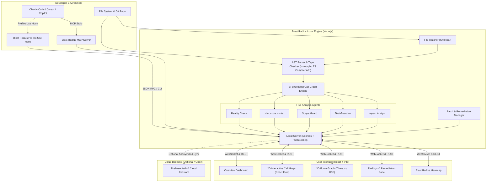

# Blast Radius Live — Technical Architecture Document

## 1. System Architecture Overview

Blast Radius Live follows a **local-first, deterministic static analysis architecture**. The computational core runs on the developer's local machine, interacting with the file system, git, and local AI agent hooks. The web frontend communicates with the local analysis server over WebSocket / HTTP REST, with optional cloud metadata sync to Firebase.

---

## 2. Component Breakdown

### 2.1 Local Core Engine (`@blast-radius/core`)
- **`ProjectGraph`**: In-memory representation of project ASTs, symbols, imports, exports, and call hierarchies.
- **`GraphBuilder`**: Traverses TypeScript AST using `ts-morph`, extracts exported declarations, resolves module specifiers, finds call references via symbol declarations.
- **`IncrementalUpdater`**: Re-parses single changed source files, invalidates affected graph edges, updates symbol table, triggers agent re-evaluation in `< 150ms`.
- **Agents Subsystem**:
  - `RealityCheckAgent`: AST verification of module specifiers, exported names, argument counts.
  - `HardcodeHunterAgent`: High-entropy string literal detector + regex rules with secret redaction.
  - `ScopeGuardAgent`: Diff against task description, flags unauthorized lockfiles and path drift.
  - `TestGuardianAgent`: Test AST detector for deleted tests, `.skip`, `.only`, empty tests, tautologies.
  - `ImpactAnalystAgent`: Computes caller fan-out, blast radius score, affected tests.

### 2.2 Claude Code Integration Hook (`@blast-radius/hooks`)
- Executes on tool events `Edit` and `Write`.
- Inspects proposed edits before writing to disk.
- Runs agents in memory on virtual file content.
- Returns `{ action: 'allow' | 'warn' | 'block', reason: string, findings: Finding[] }`.
- Includes timeout safeguards (default 3000ms) and recursion prevention via `BLAST_RADIUS_ACTIVE` environment flags.

### 2.3 Model Context Protocol (MCP) Server (`@blast-radius/mcp`)
- Implements MCP SDK standard over `stdio`.
- Exposes tools:
  - `impact(targetFile: string, targetSymbol?: string)`
  - `hotspots(threshold?: number)`
  - `findings(severity?: string, agent?: string)`
  - `fix(findingId: string, apply?: boolean)`

### 2.4 User Interface (`@blast-radius/ui`)
- Single-page application built on React 18, Vite, Tailwind CSS, Lucide icons.
- **2D Graph**: React Flow (`@xyflow/react`) with custom node types, edge animation for active blast radius paths.
- **3D Graph**: Three.js and React Three Fiber for spatial visualization, node physics layout, and WebXR readiness.
- **Heatmap**: Canvas / SVG matrix displaying risk density by directory and module.

### 2.5 Local Bridge Server (`@blast-radius/server`)
- Express + WebSocket server running on local port (default: 4567).
- Serves REST endpoints for CLI, Hooks, and UI:
  - `GET /api/graph` — Retrieve active graph nodes and edges.
  - `GET /api/findings` — Retrieve current findings.
  - `POST /api/findings/:id/dismiss` — Dismiss finding.
  - `POST /api/findings/:id/fix` — Generate or apply fix patch.
  - `POST /api/inspect-diff` — Interception endpoint for Claude Code hook.
- Pushes live updates to connected UI clients over WebSocket.

---

## 3. Data Flow & Latency Targets

| Event | Pipeline Steps | Latency Target |
|---|---|---|
| Single file saved | Watcher $\to$ Incremental AST parse $\to$ Graph update $\to$ Agents run $\to$ WS broadcast | $< 250\text{ ms}$ |
| PreToolUse Hook intercept | Hook invocation $\to$ Virtual AST parse $\to$ Rule check $\to$ Exit decision | $< 350\text{ ms}$ |
| Full Project Initial Scan | 500 files AST scan $\to$ Symbol table binding $\to$ Call graph construction | $< 3.5\text{ s}$ |
| 2D/3D Graph Re-render | React Flow / Three.js state reconciliation | 60 FPS ($< 16\text{ ms}$) |

